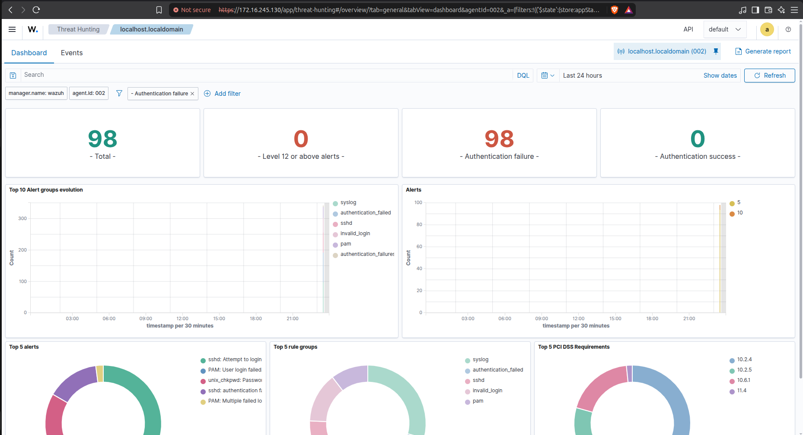
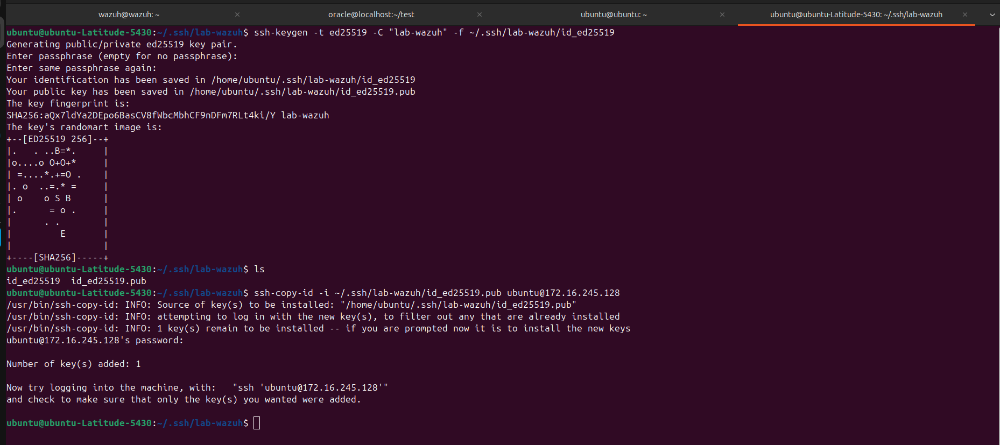
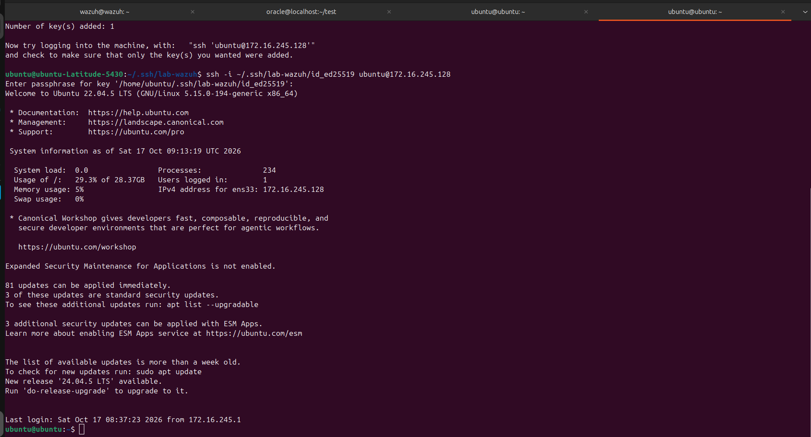
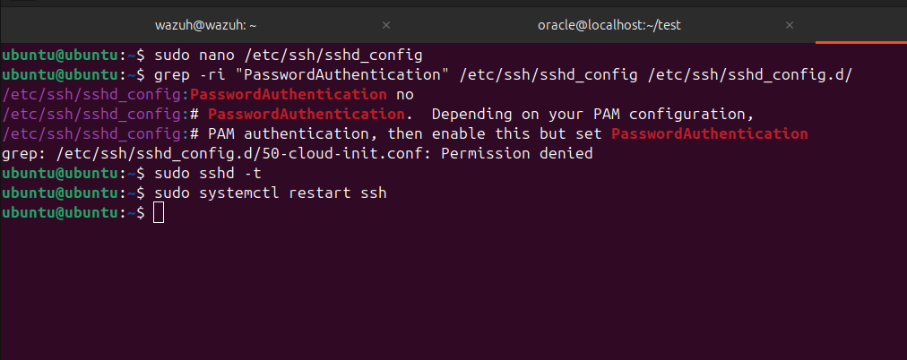
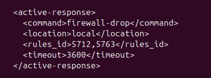
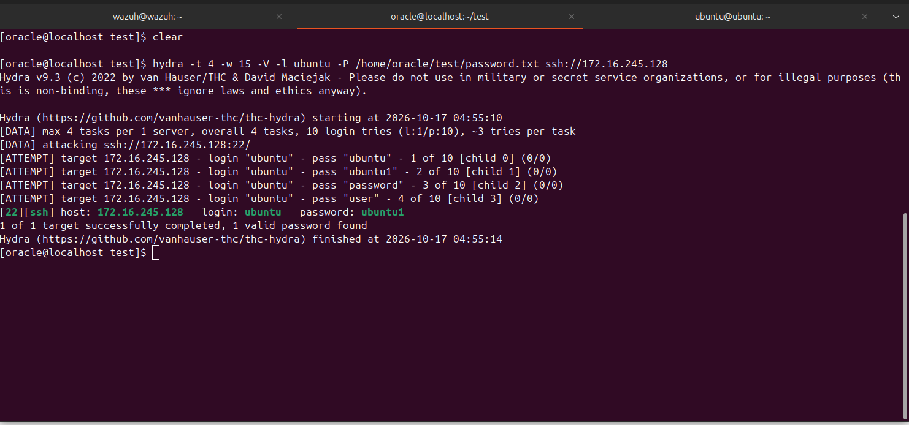

# Lab Wazuh : bloquer les attaques brute force SSH

Mise en place d'une authentification SSH **par clé uniquement** et d'un **blocage automatique des IP** qui tentent du brute force, grâce à l'Active Response de Wazuh.



## 1. Objectifs

1. Autoriser la connexion SSH uniquement par paire de clés (désactiver les mots de passe).
2. Détecter les tentatives de brute force SSH avec Wazuh.
3. Bannir automatiquement l'IP de l'attaquant (liste noire via pare-feu).

## 2. Architecture du lab

| Machine | Rôle | Système |
|---|---|---|
| PC physique | Poste d'administration (génère et garde la clé privée) | Ubuntu |
| VM `wazuh` | Serveur Wazuh (manager, indexer, dashboard) | Ubuntu 22.04 |
| VM `ubuntu` | **Cible** : serveur SSH + agent Wazuh | Ubuntu 22.04 |
| VM Oracle Linux | **Attaquante** : lance le brute force | Oracle Linux |

- Réseau : VMware en mode NAT, les VM se voient entre elles.
- IP de la cible dans ce lab : `172.16.245.128`.


### Notions utiles

- **Agent Wazuh** : programme installé sur une machine à surveiller. Il envoie ses logs au serveur, qui les analyse et peut lui ordonner une action (blocage d'IP).
- **Paire de clés SSH** : une clé **privée** (reste sur le poste client, jamais partagée) et une clé **publique** (copiée sur la cible). La connexion est acceptée si le client prouve qu'il possède la clé privée.
- **Active Response** : mécanisme de Wazuh qui exécute automatiquement un script (ici `firewall-drop`) quand une règle se déclenche.

## 3. Prérequis

- Les 3 VM démarrées et qui se joignent par `ping`.
- Un serveur SSH installé sur la cible : `sudo apt install openssh-server`.
- Un accès `sudo` sur les machines.

## 4. Étape 1 : générer la paire de clés (sur le PC physique)

La paire est générée sur la machine **depuis laquelle on se connecte**, dans un dossier dédié au TP.

```bash
mkdir -p ~/.ssh/lab-wazuh
chmod 700 ~/.ssh/lab-wazuh
ssh-keygen -t ed25519 -C "lab-wazuh" -f ~/.ssh/lab-wazuh/id_ed25519
```

- `ed25519` : algorithme moderne, rapide et sûr (RSA 4096 reste possible pour de vieux systèmes).
- Une **passphrase** protège la clé privée si elle est volée.

Fichiers obtenus :
- `id_ed25519` : clé **privée** (ne jamais la partager ni la publier)
- `id_ed25519.pub` : clé **publique**



## 5. Étape 2 : copier la clé publique sur la cible

```bash
ssh-copy-id -i ~/.ssh/lab-wazuh/id_ed25519.pub ubuntu@172.16.245.128
```

La clé publique est ajoutée dans `~/.ssh/authorized_keys` de l'utilisateur sur la cible. Vérification sur la cible :

```bash
cat ~/.ssh/authorized_keys
```

La ligne doit commencer par `ssh-ed25519` et se terminer par `lab-wazuh`.


## 6. Étape 3 : tester la connexion par clé **avant** de couper les mots de passe

```bash
ssh -i ~/.ssh/lab-wazuh/id_ed25519 ubuntu@172.16.245.128
```

La passphrase de la **clé** est demandée (et non le mot de passe de l'utilisateur). Si ce test échoue, ne passe pas à l'étape suivante, sous peine de se verrouiller dehors. Garder une session ouverte pendant toute la modification de la configuration SSH.



## 7. Étape 4 : durcir la configuration SSH (sur la cible)

### 7.1 Fichier principal

```bash
sudo nano -l /etc/ssh/sshd_config
```

Lignes à régler (enlever le `#` si la ligne est commentée) :

```
PubkeyAuthentication yes
PasswordAuthentication no
KbdInteractiveAuthentication no
PermitRootLogin no
MaxAuthTries 3
LoginGraceTime 30
X11Forwarding no
```

| Paramètre | Rôle |
|---|---|
| `PasswordAuthentication no` | Interdit les mots de passe : le brute force devient inefficace |
| `PermitRootLogin no` | Interdit la connexion directe en root |
| `MaxAuthTries 3` | Limite les essais par connexion |
| `LoginGraceTime 30` | Coupe une connexion non authentifiée après 30 s |

### 7.2 Piège : les fichiers de `sshd_config.d/`

Le fichier principal commence par `Include /etc/ssh/sshd_config.d/*.conf`. Avec sshd, **la première valeur lue l'emporte** : un fichier inclus peut donc annuler tes réglages. Recherche des conflits :

```bash
sudo grep -rniE "PasswordAuthentication|PermitRootLogin" /etc/ssh/sshd_config /etc/ssh/sshd_config.d/
```

Dans ce lab, `/etc/ssh/sshd_config.d/50-cloud-init.conf` contenait `PasswordAuthentication yes` et écrasait le réglage. Correction :

```bash
sudo nano /etc/ssh/sshd_config.d/50-cloud-init.conf
```
```
PasswordAuthentication no
```



### 7.3 Vérifier la syntaxe, appliquer, contrôler

```bash
sudo sshd -t
sudo systemctl restart ssh
sudo sshd -T | grep -Ei "passwordauthentication|permitrootlogin|maxauthtries|pubkeyauthentication"
```

Résultat attendu :

```
passwordauthentication no
permitrootlogin no
maxauthtries 3
pubkeyauthentication yes
```

`sshd -T` affiche les valeurs réellement appliquées, après prise en compte des fichiers inclus : c'est la vérification fiable.


## 8. Étape 5 : valider le durcissement

Depuis le PC physique :

**Avec la clé : la connexion doit réussir**
```bash
ssh -i ~/.ssh/lab-wazuh/id_ed25519 ubuntu@172.16.245.128
```

**Sans clé, en forçant le mot de passe : la connexion doit être refusée**
```bash
ssh -o PubkeyAuthentication=no -o PreferredAuthentications=password ubuntu@172.16.245.128
```

Résultat obtenu :
```
ubuntu@172.16.245.128: Permission denied (publickey).
```

Un simple `ssh ubuntu@172.16.245.128` échoue aussi, car la clé est dans un dossier non standard : SSH ne la propose pas sans l'option `-i`.


### Option : simplifier la commande

Dans `~/.ssh/config` (puis `chmod 600 ~/.ssh/config`) :
```
Host cible-lab
    HostName 172.16.245.128
    User ubuntu
    IdentityFile ~/.ssh/lab-wazuh/id_ed25519
    IdentitiesOnly yes
```
Ensuite `ssh cible-lab` suffit. `IdentitiesOnly yes` empêche SSH d'essayer d'autres clés, ce qui évite d'épuiser `MaxAuthTries`.

## 9. Étape 6 : installer l'agent Wazuh sur la cible **[À COMPLÉTER]**

1. Dans le dashboard Wazuh : **Agents > Deploy new agent**.
2. Choisir le système (Linux DEB amd64), saisir l'IP du serveur Wazuh et un nom d'agent.
3. Exécuter sur la cible les commandes générées par le dashboard (installation, puis démarrage du service).
4. Vérifier le service sur la cible :
```bash
sudo systemctl status wazuh-agent
```
5. Vérifier sur le serveur :
```bash
sudo /var/ossec/bin/agent_control -l
```
L'agent doit apparaître en **Active**.


## 10. Étape 7 : configurer l'Active Response (sur le serveur Wazuh)

### 10.1 Règles de détection utilisées

| ID | Signification |
|---|---|
| 5710 | Tentative avec un utilisateur inexistant |
| 5712 | Brute force SSH (utilisateur inexistant) |
| 5760 | Échec d'authentification SSH |
| 5763 | Brute force SSH (échecs répétés) |

### 10.2 Modifier `ossec.conf`

```bash
sudo cp /var/ossec/etc/ossec.conf /var/ossec/etc/ossec.conf.bak
sudo nano -l /var/ossec/etc/ossec.conf
```

La commande `firewall-drop` est **déjà déclarée par défaut** dans le fichier :

```xml
<command>
  <name>firewall-drop</name>
  <executable>firewall-drop</executable>
  <timeout_allowed>yes</timeout_allowed>
</command>
```

On ajoute, **après** cette déclaration et à l'intérieur de `<ossec_config>`, le bloc :

```xml
<active-response>
  <command>firewall-drop</command>
  <location>local</location>
  <rules_id>5712,5763</rules_id>
  <timeout>3600</timeout>
</active-response>
```

- `location local` : le blocage s'applique sur l'agent qui a généré l'alerte (la cible).
- `timeout 3600` : blocage d'une heure (en secondes). Supprimer la ligne pour un blocage permanent.

### 10.3 Liste blanche (pour ne pas se bannir soi-même)

Dans la section `<global>` :
```xml
<white_list>172.16.245.1</white_list>
```
Cette adresse est celle du PC physique vue depuis les VM (interface virtuelle VMnet8).

### 10.4 Vérifier la configuration puis redémarrer

```bash
sudo /var/ossec/bin/wazuh-analysisd -t
sudo systemctl restart wazuh-manager
sudo systemctl status wazuh-manager
```

Le statut doit afficher `active (running)`.



## 11. Étape 8 : tester l'attaque (lab uniquement) **[À COMPLÉTER]**

Depuis la VM Oracle Linux, installer un outil de brute force (par exemple `hydra`, disponible via les dépôts EPEL) puis l'exécuter **uniquement contre la cible du lab** :

```bash
hydra -l ubuntu -P liste_mots_de_passe.txt ssh://172.16.245.128 -t 4
```

**Remarque importante** : une fois les mots de passe désactivés, les échecs sont journalisés différemment (souvent `Connection closed by authenticating user ... [preauth]`), et les règles 5712 et 5763 peuvent se déclencher moins facilement. Pour observer clairement la détection et le blocage, on peut tester une première fois avec `PasswordAuthentication yes` temporairement, puis le remettre à `no` et refaire le test.



## 12. Étape 9 : vérifier la détection et le blocage **[À COMPLÉTER]**

1. **Dashboard Wazuh** : *Threat Hunting / Security events*, filtre `rule.id: 5712 OR 5763`.
2. **Sur la cible**, l'IP de l'attaquant doit être bloquée :
```bash
sudo iptables -L -n | grep IP_ATTAQUANT
```
3. **Journal de l'Active Response** (sur la cible) :
```bash
sudo tail -f /var/ossec/logs/active-responses.log
```

Pour débloquer manuellement une IP :
```bash
sudo iptables -D INPUT -s IP_ATTAQUANT -j DROP
```


## 13. Problèmes rencontrés et solutions

### 13.1 `wazuh-manager` ne redémarre pas

**Symptôme**
```
Job for wazuh-manager.service failed because the control process exited with error code.
```

**Diagnostic**
```bash
sudo tail -n 30 /var/ossec/logs/ossec.log
sudo /var/ossec/bin/wazuh-analysisd -t
```
```
wazuh-analysisd: ERROR: (1303): Invalid command 'firewall-drop' in the active response.
```

**Cause** : le bloc `<active-response>` était placé **avant** la déclaration `<command>` de `firewall-drop`. Wazuh lit `ossec.conf` de haut en bas : une commande doit être déclarée avant d'être utilisée.

**Solution** : déplacer le bloc `<active-response>` après les déclarations `<command>`, puis tester avec `wazuh-analysisd -t` et redémarrer.

### 13.2 Connexion possible avec mot de passe malgré `PasswordAuthentication no`

**Cause** : `/etc/ssh/sshd_config.d/50-cloud-init.conf` contenait `PasswordAuthentication yes` et était lu avant le fichier principal.

**Solution** : corriger ce fichier, puis contrôler avec `sudo sshd -T`.

### 13.3 La clé n'est pas utilisée automatiquement

**Cause** : la clé est dans `~/.ssh/lab-wazuh/`, un emplacement non standard.

**Solution** : utiliser `-i`, ou déclarer l'hôte dans `~/.ssh/config` avec `IdentityFile`.

## 14. Bonnes pratiques de sécurité

- Tester la connexion par clé **avant** de couper les mots de passe, et garder une session ouverte.
- Ne jamais copier la clé privée sur la cible, le serveur Wazuh ou l'attaquante.
- Une passphrase sur chaque clé privée.
- Ne jamais lancer d'attaque en dehors de son propre lab.
- Mettre sa propre IP en liste blanche dans Wazuh.

## 15. Pour aller plus loin

- **MFA SSH** : ajouter un code temporaire (Google Authenticator) en plus de la clé.
- **fail2ban** : alternative locale à l'Active Response (à ne pas utiliser en même temps que Wazuh dans ce lab).
- **Splunk** : envoyer les alertes Wazuh vers Splunk (Universal Forwarder sur le serveur Wazuh) pour l'analyse des logs.

## 16. Conclusion

L'authentification par clé rend le brute force sur mots de passe inefficace, et Wazuh apporte la **visibilité** (alertes) et la **réaction automatique** (bannissement d'IP). Les deux protections sont complémentaires.
